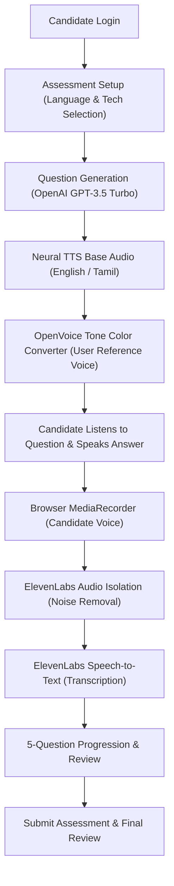

# Vani_AI-Demo

# Vani AI — AI-Powered Voice Assessment Platform

Vani AI is a complete, full-stack voice assessment web application featuring:

- **Reference Voice Cloning**: Every technical assessment question is spoken aloud in the user's voice using **OpenVoice v2** tone color conversion.
- **Bilingual Assessment**: Supports questions and speech in both **English** and **Tamil**.
- **AI Scenario-Based Questions**: Progressive technical interview scenarios for **Python, Java, JavaScript, TypeScript, C++, C#, C, SQL, Go, Rust**.
- **ElevenLabs Integration**: Official **Audio Isolation API** to strip background noise from candidate answers and **Speech-to-Text API** for accurate transcription.
- **5-Question Assessment Workflow**: Candidate voice recording, real-time audio playback, answer preservation across questions, confirmation modal, and read-only answer review.

---

## Architecture & Workflow



---

## Directory Structure

```
vani-ai/
├── run.py                       # Single-command launcher for complete web platform
├── README.md                    # Documentation & setup guide
├── backend/
│   ├── .env                     # API keys (OPENAI_API_KEY, ELEVENLABS_API_KEY)
│   ├── .env.example             # Template for environment variables
│   ├── requirements.txt         # Python dependencies
│   ├── app/
│   │   ├── main.py              # FastAPI server with CORS & SPA static mount
│   │   ├── config.py            # Environment & model configurations
│   │   ├── database.py          # SQLite database schema (users & assessments)
│   │   ├── routers/
│   │   │   ├── auth.py          # Candidate login & session authentication
│   │   │   ├── assessment.py    # Start, question audio, answer upload, submit, review
│   │   │   └── system.py        # OpenAI, ElevenLabs, OpenVoice health status
│   │   └── services/
│   │       ├── voice_service.py # OpenVoice ToneColorConverter + Edge-TTS
│   │       ├── question_service.py # OpenAI GPT-3.5 Turbo scenario questions
│   │       └── elevenlabs_service.py # ElevenLabs Audio Isolation & STT
│   ├── voice_reference/
│   │   ├── reference_voice.wav  # User reference recording (16kHz PCM WAV)
│   │   ├── reference_voice.ogg  # User uploaded original audio
│   │   └── reference_speaker_embedding.pth # Extracted reference voice embedding
│   ├── models/checkpoints_v2/   # OpenVoice converter weights
│   ├── cache/audio/             # Cloned question audio cache
│   └── uploads/recordings/      # Candidate audio recordings & isolated audio
└── frontend/
    ├── package.json             # React 18, Vite, Lucide React
    ├── vite.config.js           # Dev server & /api proxy
    ├── src/
    │   ├── App.jsx              # Main SPA router & state container
    │   ├── index.css            # Custom CSS & glassmorphic styling
    │   └── components/
    │       ├── Header.jsx       # Brand, reference voice status, user profile
    │       ├── LoginPage.jsx    # Candidate login with validation
    │       ├── SetupPage.jsx    # Language selection & reference voice sample preview
    │       ├── AssessmentPage.jsx # 5-question workflow, player, recorder
    │       ├── SuccessPage.jsx  # 'Your answers have been submitted successfully!'
    │       └── ReviewPage.jsx   # Read-only review with candidate audio & transcripts
```

---

## How to Run the Application

### Option 1: Single-Command Quickstart (Recommended)

From the project root:

```powershell
cd C:\Users\babum\.gemini\antigravity\scratch\vani-ai
python run.py
```

Then open your browser at:
👉 **`http://localhost:8000`**

---

### Option 2: Full Dev Mode (Separate Backend & Frontend with Hot-Reload)

**Terminal 1 — Backend:**

```powershell
cd C:\Users\babum\.gemini\antigravity\scratch\vani-ai\backend
$env:PYTHONPATH = "."
python -m uvicorn app.main:app --host 0.0.0.0 --port 8000 --reload
```

**Terminal 2 — Frontend:**

```powershell
cd C:\Users\babum\.gemini\antigravity\scratch\vani-ai\frontend
npm run dev
```

Then open your browser at:
👉 **`http://localhost:5173`**

---

## API Configuration

To enable OpenAI question generation, ElevenLabs STT/audio isolation, and Gnani AI voice-cloned TTS:

Edit `backend/.env`:

```env
OPENAI_API_KEY=your_openai_api_key_here
ELEVENLABS_API_KEY=your_elevenlabs_api_key_here
GNANI_API_KEY_ID=your_gnani_api_key_id_here
JWT_SECRET=vani_ai_secret_key_super_secure_2026
```

Gnani voice-cloned TTS creates and caches an embedding from the first 30 seconds of the local reference recording. Replace `GNANI_API_KEY_ID` with your key ID in `backend/.env`; do not put API keys in frontend code or commit them.

> **Note**: Even before entering API keys:
>
> - Voice-cloned TTS uses Gnani AI when configured; Edge-TTS with local OpenVoice is the fallback.
> - Curated scenario questions in English and Tamil for all 10 programming languages are immediately ready.
> - Candidate recording & fallback speech-to-text operates seamlessly without discarding any candidate speech.

# Vani_AI-Demo
